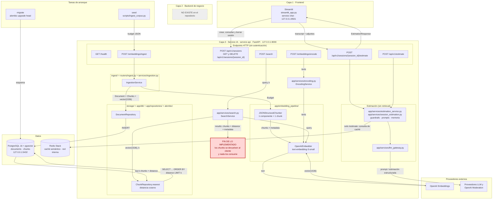
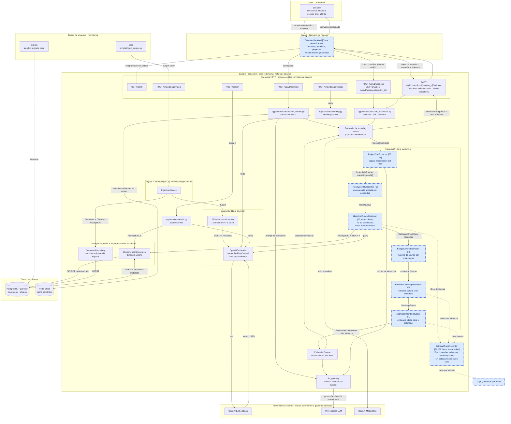

# Diagnóstico arquitectónico — Sesión 09 (pre-work)

## Resumen
Hay capacidades que no están conectadas. El sistema sabe generar estimaciones de proyectos con inteligencia artificial, y también sabe buscar en nuestro archivo de presupuestos históricos. Pero al estimar no consulta ese archivo, así que las cifras no se apoyan en lo que nos costaron de verdad proyectos parecidos.

Para comprobarlo, probamos el sistema con una reunión simulada de cinco minutos con el dueño de una tienda gourmet, que quiere vender por internet, cobrar con tarjeta, tener un club de puntos, un panel de control y avisos por correo.

Encontramos cinco problemas, de mayor a menor impacto:

1. El archivo no llega a la estimación. La búsqueda encuentra datos útiles, como un carrito de compra que requirió 140 horas, pero ese dato no se usa al estimar.
2. La reunión no cabe en el buscador. Admite 2.000 caracteres y esta reunión tiene unos 2.850, así que la rechaza.
3. Las peticiones se mezclan. Cuando forzamos la búsqueda con toda la reunión, acertó el sector, pero de cinco resultados solo uno era claramente útil y otros dos lo eran en parte. Puntos, panel y correos no aparecieron.
4. Falta variedad. Cuatro de los cinco resultados venían del mismo proyecto antiguo, que además parece más complejo de lo que necesita esta tienda. Con una sola referencia, una estimación puede salir desviada sin que nadie lo note.
5. El sistema no avisa de lo que no sabe. No tenemos ningún proyecto de club de puntos en el archivo, y nada lo señala.

También vimos dos carencias de control. No hay inicio de sesión ni permisos, y el acceso a los datos no pasa por una capa intermedia. Hoy es asumible porque funciona solo en entorno local, pero habría que resolverlo antes de abrirlo a clientes o a toda la empresa.

Proponemos que el sistema trabaje como un buen consultor: entender qué pide el cliente, buscar referencias para cada necesidad, comparar varios proyectos, decir qué no está respaldado y citar de dónde sale cada cifra. Añadiríamos además una capa de acceso con usuarios y permisos, y un registro de qué información se usó en cada estimación.

Si solo pudiéramos construir una pieza, sería la que conecta el archivo con la estimación, porque sin ella ninguna otra mejora llega al resultado. Eso sí, por sí sola arrastraría las limitaciones de la búsqueda actual, así que el siguiente paso sería mejorar cómo se interpreta la reunión.

Conviene tener claros tres límites. Son pruebas con pocas consultas y un archivo pequeño, de 15 presupuestos, así que señalan problemas reales, pero no permiten calcular cuánto mejorarían las estimaciones. Tampoco hemos medido aún la calidad de las estimaciones actuales ni calculado el coste y el plazo de esta evolución. Creo que es mejor empezar por esa primera pieza, comparando las estimaciones antes y después de conectarla.

## 1. Diagrama de la arquitectura actual

Estado de la rama `session-09/pre-work`, partiendo de `master` tras integrar la Sesión 08. Las carpetas `ingest/` y `storage/` no existen con ese nombre: el diagrama indica qué código cumple cada función.



**Leyenda**

- **Quién habla con quién:** Streamlit llama solo a las rutas de `/api/v1/sessions`. `seed` llama a `/embeddings/ingest`. La ingesta, `/embeddings/encode` y `/search` comparten `OpenAIEmbedder`, y solo los dos repositorios acceden a `documents` y `chunks`.
- **Qué se expone al exterior:** `api` publica sus 9 rutas en `127.0.0.1:8000`, `chat` en `127.0.0.1:8501` y `postgres` en `127.0.0.1:5432`; Redis solo es accesible desde la red interna. En `app/` no aparece ningún mecanismo de autenticación (búsqueda de `HTTPBearer`, `APIKeyHeader`, `OAuth2`, `Authorization` y `Security(`: 0 resultados).
- **Acceso desde el frontend:** el frontend llama **directamente** al servicio IA (`API_BASE_URL=http://api:8000`), porque no hay backend de negocio en medio.
- **Dónde termina lo implementado:** hoy conviven dos flujos sin conexión. `POST /search` encuentra chunks parecidos, pero solo los devuelve al cliente. Los flujos de estimación generan su resultado con el LLM sin recuperar nada: `SearchService` y `ChunkRepository` solo se usan desde la ruta `/search`.

---

## 2. Trace anotado de `02_ambiguous.txt`

Todas las cifras salen de una única ejecución (`20261101T170202Z`), con el corpus de 15 presupuestos y 52 chunks. Las respuestas crudas completas están en `docs/session-09/trace/`.

Comando de todos los pasos:

```bash
docker compose up -d
uv run --no-sync --env-file .env python scripts/session09_trace.py
```

El script solo hace llamadas HTTP y `SELECT` dentro de una transacción de solo lectura que termina en `ROLLBACK` (`transaction_read_only = on`). Cada paso indica la llamada concreta que hace el script.

### Paso 1 — Medir la entrada

```text
tiktoken.encoding_for_model("text-embedding-3-small")
SELECT content FROM chunks
POST /embeddings/encode  {"texts": ["word " * 9000]}    # texto sintético, sin datos de cliente
```

| Entrada | Caracteres | Tokens | Veces un chunk medio (tokens) | % del límite de 8191 tokens|
|---|---:|---:|---:|---:|
| `02_ambiguous.txt` | 2853 | 890 | 11,2 | 10,9 % |
| `01_clear.txt` | 1974 | 599 | 7,5 | 7,3 % |
| Chunk medio del corpus (mín.–máx.) | 372,8 (308–450) | 79,3 (66–106) | 1 | 1,0 % |

 El límite de tokens de entrada del modelo de embeddings es de 8191 tokens

Respuesta cruda de la prueba por encima del límite (9001 tokens):

```json
{"detail": [{"type": "text_too_long", "loc": ["body", "texts", 0], "msg": "Text exceeds 8191 tokens"}], "request_id": "4f02746bc63d4d5b92864664aacc6f55"}
```

**Comentario:** la transcripción no se acerca al límite del modelo, y por encima de él `/embeddings/encode` responde 422 en lugar de truncar. El límite que sí afecta a esta transcripción es otro: el de 2000 caracteres de `/search` (Paso 3).

### Paso 2 — Embeber la transcripción completa

```text
POST /embeddings/encode  {"texts": [<02_ambiguous.txt>, <01_clear.txt>, <frase 1>, <frase 2>]}
```

Respuesta `200` en 2114,3 ms. El vector completo está en `20261101T170202Z_step2_encode.json`.

```json
{"dimensions": 1536, "l2_norm": 0.9999279804931279, "first_component": 0.007080078125, "last_component": 0.0201263427734375}
```

**Comentario:** el vector resume en un solo punto toda la conversación: tienda, puntos, panel, pago, Francia, correos y charla personal. A partir del Paso 4, los temas de catálogo y carrito dominan el resultado y varios de los demás no aparecen.

### Paso 3 — Búsqueda semántica top-5

**Intento con la transcripción completa:**

```text
POST /search  {"query": <02_ambiguous.txt>, "k": 5}
```

Respuesta cruda, `422` en 6,4 ms:

```json
{"detail": [{"type": "string_too_long", "loc": ["body", "query"], "msg": "String should have at most 2000 characters", "ctx": {"max_length": 2000}}], "request_id": "187964be739844128e201457c1e46c83"}
```

**El endpoint rechaza la transcripción: con 2853 caracteres, supera su límite de 2000.** Las sesiones admiten hasta 20 000 (`MAX_TRANSCRIPT_CHARS`), así que una transcripción válida para estimar puede no serlo para buscar.

**Ranking equivalente con el vector del Paso 2:** para obtener el top-5 sin cambiar la configuración, se aplica la misma distancia coseno por SQL.

```sql
SELECT c.id AS chunk_id, c.document_id, c.chunk_type, c.content,
       c.metadata::text AS metadata, d.metadata::text AS document_metadata,
       c.embedding <=> $1::text::vector AS distance
FROM chunks c
JOIN documents d ON d.id = c.document_id
WHERE c.embedding IS NOT NULL
ORDER BY distance
LIMIT $2
```

Respuesta recortada: `content` se reduce al nombre del componente y se omiten `chunk_type` y los metadatos del documento. La completa está en `20261101T170202Z_step3_sql_top5_ambiguous.json`.

```json
[
  {"chunk_id": 16, "document_id": 5, "content": "Component: Product catalog API [...]", "distance": 0.6105203608411944},
  {"chunk_id": 17, "document_id": 5, "content": "Component: Cart and checkout service [...]", "distance": 0.6159868325307061},
  {"chunk_id": 18, "document_id": 5, "content": "Component: Personalized recommendations [...]", "distance": 0.6396230138333749},
  {"chunk_id": 19, "document_id": 5, "content": "Component: Storefront PWA [...]", "distance": 0.6404981079396186},
  {"chunk_id": 27, "document_id": 8, "content": "Component: Returns portal [...]", "distance": 0.6432356029776025}
]
```

**Comprobación del método:** en las tres consultas que `/search` sí acepta (`01_clear.txt` y las dos frases), el SQL devuelve los mismos chunks en el mismo orden. La mayor diferencia de distancia es 0,00052. Una segunda ejecución completa, hecha para validar el comando y no conservada, devolvió los mismos chunks en el mismo orden en las cuatro consultas, con variaciones de distancia de hasta 0,0003, así que las cifras son reproducibles en el orden, no al último decimal.

### Paso 4 — Análisis de cada chunk devuelto

Comando: la misma consulta SQL de solo lectura del Paso 3, que ya trae `c.metadata` y `d.metadata` (`20261101T170202Z_step3_sql_top5_ambiguous.json`). Menor distancia significa mayor parecido. La relevancia es una valoración manual frente a lo que pide Rubén.

| # | chunk_id | Presupuesto histórico | Sector | Score (distancia) | ¿Relevante para la petición? | Comentario |
|---|---|---|---|---:|---|---|
| 1 | 16 | BUD-2024-005 · Headless e-commerce storefront (460 h) | ecommerce | 0,6105 | Parcial | Cubre el catálogo, pero con GraphQL, Elasticsearch y multidivisa: excesivo para una tienda que empieza. |
| 2 | 17 | BUD-2024-005 | ecommerce | 0,6160 | Sí | Carrito y checkout con proveedor de pago: encaja con pagar con tarjeta sin abandonar en el último paso. |
| 3 | 18 | BUD-2024-005 | ecommerce | 0,6396 | No | Recomendaciones personalizadas: Rubén no las pide. Se parece por el sector, no por la necesidad. |
| 4 | 19 | BUD-2024-005 | ecommerce | 0,6405 | Parcial | La tienda web es necesaria, pero este componente es una PWA sobre una arquitectura headless. |
| 5 | 27 | BUD-2024-008 · Fashion returns and resale (300 h) | ecommerce | 0,6432 | No | Portal de devoluciones: nadie lo menciona en la reunión. |

**Comentario:** el top-5 acierta el sector, pero no responde a la petición: solo 1 chunk es claramente relevante, 2 lo son en parte y **4 de los 5 proceden del mismo presupuesto** (BUD-2024-005), así que una estimación tendría casi una sola referencia de horas. La búsqueda encuentra «tienda online» en general, mientras que lo específico de Rubén (fidelización, panel y correo) queda fuera.

**Necesidades de Rubén sin cubrir en el top-5:**

| Necesidad | Qué hay en el corpus |
|---|---|
| Puntos o club de fidelización | Buscar `loyalty` o `reward points` en `data/budgets_sample.json` no da resultados |
| Panel de pedidos, ventas y stock | El más cercano es `Merchant dashboard` (finance), en el puesto 8; ningún componente de ecommerce se llama así |
| Control de stock | El chunk 16 solo menciona de pasada «inventory availability»; `Real-time inventory sync` (ecommerce) está en el puesto 6 |
| Correo al comprar | `Push and email notifications` (finance) existe, pero queda fuera del top-20 |

### Paso 5 — Medidas de contraste

```text
POST /search  {"query": <01_clear.txt>, "k": 5}                               # 200, 981,4 ms
POST /search  {"query": "lo ideal sería vender por internet, eso seguro. Que la gente entre, vea los productos y compre", "k": 5}    # 200, 356,8 ms
POST /search  {"query": "que la gente pueda pagar con tarjeta, claro. Eso es fundamental, que el pago sea fácil y seguro", "k": 5}   # 200, 179,1 ms
SELECT ... ORDER BY distance LIMIT 20    # una vez por cada vector del Paso 2
```

Desviación típica poblacional. Distancias de la consulta SQL (`20261101T170202Z_step5_contrast.json`).

| Consulta | Distancia top-1 | Distancia top-5 | Diferencia top-5 | Desv. top-5 | Diferencia top-20 | Desv. top-20 | Sector del top-5 | Presupuesto más repetido en el top-5 |
|---|---:|---:|---:|---:|---:|---:|---|---|
| `02_ambiguous` completa | 0,6105 | 0,6432 | 0,0327 | 0,0138 | 0,0899 | 0,0261 | ecommerce (5) | BUD-2024-005 (4) |
| `01_clear` completa | 0,4209 | 0,4874 | 0,0665 | 0,0246 | 0,1492 | 0,0470 | finance (5) | BUD-2024-001 (4) |
| Frase «vender por internet» | 0,7498 | 0,7975 | 0,0477 | 0,0163 | 0,1269 | 0,0368 | ecommerce (5) | BUD-2024-005 (4) |
| Frase «pagar con tarjeta» | 0,6899 | 0,7782 | 0,0883 | 0,0321 | 0,1528 | 0,0411 | finance (5) | BUD-2024-003 (4) |

**Respuesta cruda recortada** a los componentes y distancias de `/search` (`20261101T170202Z_step5_search_clear.json` y `20261101T170202Z_step5_search_phrases.json`):

```text
01_clear
  2  0.4212  BUD-2024-001  PSD2 open banking connectors
  1  0.4335  BUD-2024-001  OAuth 2.0 authentication backend
  3  0.4469  BUD-2024-001  Transaction ledger service
  4  0.4727  BUD-2024-001  Push and email notifications
  9  0.4877  BUD-2024-003  Payment gateway core

Frase «vender por internet»
  16 0.7498  Product catalog API
  19 0.7639  Storefront PWA
  17 0.7709  Cart and checkout service
  18 0.7828  Personalized recommendations
  27 0.7976  Returns portal

Frase «pagar con tarjeta»
  9  0.6899  Payment gateway core
  12 0.7147  Merchant dashboard
  10 0.7395  Real-time fraud detection
  11 0.7642  Settlement reconciliation
  2  0.7782  PSD2 open banking connectors
```

**Comentario:**

- **Ambigua frente a clara:** con `01_clear.txt`, el top-1 está 0,19 más cerca y los dos primeros resultados son justo lo pedido (PSD2 y OAuth). La entrada ambigua da peor resultado y tiene la menor dispersión de las cuatro consultas.
- **Frases sueltas frente a transcripción:** no mejoran por sí solas. «Vender por internet» recupera los mismos cinco chunks con más distancia. «Pagar con tarjeta» se va entero a finance: al perder el contexto de tienda, devuelve una pasarela de pagos, detección de fraude y conciliación.

**Trazabilidad:** los logs de `api` registran `search.completed` con `k`, número de resultados y tiempo, pero no qué chunks se recuperaron (`app/services/search.py:49`).

### Resumen de observaciones

- **La transcripción ni siquiera entra en la búsqueda:** `POST /search` responde 422 porque tiene 2853 caracteres y el máximo es 2000 (Paso 3). Las sesiones admiten 20 000.
- **La recuperación acierta el sector, pero no la necesidad:** los 5 chunks son de ecommerce, y solo 1 es claramente relevante y 2 lo son en parte (Paso 4).
- **Un presupuesto copa el resultado:** 4 de 5 chunks son de BUD-2024-005, y lo mismo ocurre, con su propio presupuesto, en las otras tres consultas (Pasos 4 y 5).
- **La entrada ambigua rinde peor que la clara:** su top-1 está a 0,6105 frente a 0,4209, y la diferencia en su top-5 es de 0,0327 frente a 0,0665 (Paso 5).
- **Parte de lo pedido no se recupera:** en el top-5 no aparecen fidelización, panel ni correo, y el stock solo de pasada; la fidelización ni siquiera está en el corpus (Paso 4).
- **Extraer frases no basta:** la frase de pago lleva el top-5 entero a finance, y las distancias de las frases (0,69–0,80) no son comparables con las de la transcripción (Paso 5).

---

## 3. Diagnóstico: cinco fallos identificados

Ordenados por impacto en la calidad de la estimación final, de mayor a menor.

### Fallo 1 — La búsqueda no alimenta la estimación
- **Problema observado:** en el Paso 4 los chunks traen horas reales (150, 140, 110, 60 y 140 h), pero el flujo termina al devolverlos: `SearchService` y `ChunkRepository` solo se usan desde la ruta `/search`, y las estimaciones se generan con el LLM sin consultarlos.
- **Causa probable:** la Sesión 08 construyó la recuperación como una capacidad aislada y no existe ninguna etapa que conecte sus resultados con el flujo de estimación.
- **Propuesta de solución:** añadir una etapa que convierta los chunks recuperados en contexto para la estimación y que deje constancia de qué presupuestos históricos la respaldan.

### Fallo 2 — La transcripción no cabe en la búsqueda
- **Problema observado:** en el Paso 3, `POST /search` responde 422 porque `02_ambiguous.txt` tiene 2853 caracteres y el máximo es 2000; `01_clear.txt` (1974) entra por solo 26 caracteres, y las sesiones admiten hasta 20 000.
- **Causa probable:** `/search` está pensado para consultas cortas (`SEARCH_QUERY_MAX_LENGTH=2000`) y nada transforma una transcripción en consultas que quepan en ese límite.
- **Propuesta de solución:** no enviar la transcripción en bruto a la búsqueda, sino derivar de ella consultas acotadas, con límites coherentes entre la entrada de la transcripción y la de la búsqueda.

### Fallo 3 — Un solo vector para una conversación con varias necesidades
- **Problema observado:** en el Paso 4 solo 1 de 5 chunks es claramente relevante y faltan fidelización, panel y correo; en el Paso 5 el top-1 empeora de 0,4209 (`01_clear`) a 0,6105 (`02_ambiguous`), y la frase suelta sobre el pago lleva los 5 resultados a finance.
- **Causa probable:** la conversación completa, con su ruido y varios temas, se resume en un único vector, y no hay ninguna pieza que separe las necesidades ni conserve el contexto del proyecto.
- **Propuesta de solución:** extraer de la transcripción las necesidades y el contexto del cliente, y hacer una búsqueda por necesidad en lugar de una sola búsqueda global.

### Fallo 4 — Un único presupuesto copa los resultados
- **Problema observado:** en el Paso 4, 4 de 5 chunks son de BUD-2024-005, y en el Paso 5 se repite el 4 de 5 en las otras tres consultas (BUD-2024-001, BUD-2024-005 y BUD-2024-003).
- **Causa probable:** cada componente es un chunk con la misma cabecera de proyecto y el ranking ordena solo por distancia, sin tener en cuenta de qué presupuesto procede cada resultado.
- **Propuesta de solución:** añadir una regla de diversidad por presupuesto al seleccionar resultados, para que la estimación compare varios proyectos históricos.

### Fallo 5 — El sistema no avisa cuando la evidencia es insuficiente
- **Problema observado:** siempre se devuelven k resultados: el Paso 4 incluye `Returns portal` (0,6432), que nadie pide, y nada avisa de que no hay fidelización en el corpus; en el Paso 5 también devuelve 5 resultados con distancias de hasta 0,7975.
- **Causa probable:** `ChunkRepository.nearest` aplica solo `ORDER BY distance LIMIT k`, sin criterio de relevancia ni comprobación de qué necesidades quedan cubiertas.
- **Propuesta de solución:** añadir una etapa que valore si la evidencia cubre cada necesidad y que declare los huecos; no debería basarse en un umbral fijo, porque el Paso 5 muestra que las distancias varían con el tipo de consulta (0,61 con la transcripción y 0,75 con una frase para el mismo chunk).

### Explicación funcional de los cinco fallos

Los mismos fallos en términos funcionales, con la reunión de Rubén como ejemplo. Los ejemplos de solución son ilustrativos: nada de esto está construido.

#### F1: La búsqueda no alimenta la estimación
- **Qué significa:** tenemos un archivo con proyectos pasados, pero quien hace el presupuesto no lo abre.
- **Evidencia:** la búsqueda encuentra `Cart and checkout service`, un trabajo real de 140 horas parecido a lo que necesita Rubén. Ese dato se queda ahí, y la estimación se genera sin usarlo.
- **Solución:** antes de estimar, el sistema consulta proyectos parecidos y se los pasa al estimador. El resultado podría decir: «Carrito y pago: unas 140 h, según BUD-2024-005». Así, el consultor puede comprobar de dónde sale cada cifra.

#### F2: La transcripción no cabe en la búsqueda
- **Qué significa:** el buscador solo admite textos cortos, y una reunión normal no cabe.
- **Evidencia:** la reunión con Rubén dura unos 5 minutos y ocupa 2853 caracteres, pero el máximo son 2000, así que la búsqueda la rechaza sin devolver ningún resultado. Las sesiones de estimación, en cambio, sí aceptarían esa reunión.
- **Solución:** no se busca con la reunión entera, sino con frases cortas sacadas de ella, como «tienda online de productos gourmet con pago con tarjeta». Al ser cortas, siempre caben.

#### F3: Un solo vector para varias necesidades
- **Qué significa:** es como pedirle a un bibliotecario cinco libros distintos en una sola frase larga llena de anécdotas: te dará lo más general, no lo que necesitas.
- **Evidencia:** Rubén habla de tienda, pago, puntos, panel y correos, además de su familia y su primo en Francia. La búsqueda devuelve cosas de «tienda online» en general, y se pierden los puntos, el panel y los correos.
- **Solución:** primero se saca una lista de necesidades y se hace una búsqueda para cada una. Cada búsqueda debe conservar el contexto, porque «pagar con tarjeta» a secas devolvió pasarelas de pago y detección de fraude de finance, no el pago de una tienda.

#### F4: Un presupuesto copa los resultados
- **Qué significa:** pides cinco referencias y recibes casi cinco piezas de un mismo proyecto.
- **Evidencia:** 4 de los 5 resultados son de BUD-2024-005, un proyecto con GraphQL y Elasticsearch, probablemente más complejo de lo que necesita una tienda pequeña. Si la estimación se apoya casi solo en él, puede heredar ese sobredimensionamiento, y no hay otro proyecto con el que comparar.
- **Solución:** limitar cuántos resultados puede aportar cada proyecto, por ejemplo dos, para comparar horas de varios y detectar cuándo uno se sale de lo normal.

#### F5: No avisa cuando la evidencia es insuficiente
- **Qué significa:** el sistema responde siempre con la misma seguridad, sepa o no del tema, igual que alguien que nunca dice «de esto no tengo datos».
- **Evidencia:** Rubén pide un club de puntos y el corpus no tiene ningún proyecto de fidelización, pero nada lo avisa. En cambio, aparece un portal de devoluciones que nadie ha pedido. El riesgo es que la cifra de los puntos parezca igual de fiable que las demás sin tener respaldo.
- **Solución:** el sistema indica qué tiene respaldado y qué no. Por ejemplo, carrito y pago irían con referencias históricas, y el club de puntos, sin referencias, con menos confianza o con una pregunta para el cliente.

#### Cómo encaja todo

| Hoy | Con las soluciones |
|---|---|
| La reunión no cabe en el buscador | Se extraen las necesidades de Rubén (F2, F3) |
| Una búsqueda mezcla todos los temas | Se hace una búsqueda corta por necesidad (F2, F3) |
| Casi todo viene de un solo proyecto | Se comparan varios proyectos (F4) |
| Nada avisa de lo que falta | Se señala qué necesidades no tienen respaldo (F5) |
| La estimación no usa nada de lo encontrado | La estimación usa esas referencias y las cita (F1) |

### Otros fallos observados

- **Sin filtros por metadatos:** `client_sector` existe con índice GIN, pero `nearest` no filtra por él y la frase sobre el pago devuelve 5 de 5 chunks de finance (Paso 5).
- **Trazabilidad insuficiente:** `search.completed` registra `k`, el número de resultados y el tiempo, pero no qué chunks se recuperaron (`app/services/search.py:49`).
- **Endpoints sin autenticación:** en `app/` no aparece ningún mecanismo de autenticación, de modo que quien alcance `127.0.0.1:8000` puede usar la ingesta, el encode y la búsqueda, y las tres generan coste en OpenAI.
- **Frontend sin intermediario:** Streamlit llama directamente al servicio IA porque no existe backend de negocio (sección 1).
- **`/search` sin guardrails:** ni su router ni su servicio aplican las comprobaciones de entrada que sí usan los flujos de estimación, y su texto se envía a OpenAI.
- **Cobertura del corpus limitada:** son 15 presupuestos y 52 chunks; no hay fidelización, y en ecommerce ningún componente se presenta como panel (Paso 4).

### Hipótesis comprobadas y descartadas

- **Truncado silencioso:** no ocurre en estos endpoints. `/embeddings/encode` y `/search` responden 422 al superar su límite (Pasos 1 y 3).
- **Compresión de similitudes por longitud:** no está demostrada. `02_ambiguous` tiene la menor dispersión (0,0327), pero `01_clear`, también larga, tiene una mayor (0,0665) que la frase corta «vender por internet» (0,0477) (Paso 5).
- **Transcripciones en los logs:** no se han observado en las líneas revisadas, y `search.py` y `encoding.py` evitan registrar el texto a propósito.

---

## 4. Propuesta de evolución arquitectónica

Misma arquitectura de tres capas que en la sección 1, con el flujo completo de transcripción a estimación. Las cajas azules con borde discontinuo son **nuevas**, y entre corchetes se indica qué fallo resuelve cada una. Los nombres son propuestas y nada de esto está implementado. El resto de cajas ya existe y se mantiene: el diagrama incluye todos los componentes de la sección 1.



**Leyenda**

| Componente nuevo | Qué resuelve | Prácticas que refleja |
|---|---|---|
| `EstimatorBackend` | Otros: sin autenticación y frontend sin intermediario | Autenticación del usuario y aislamiento del servicio IA, que recibe un token de servicio |
| `ProjectBriefExtractor` | F2, F3 | Contrato tipado (`ProjectBrief`) y prompt y esquema versionados |
| `NeedQueryBuilder` | F2, F3 | Consultas de tamaño acotado |
| `HistoricalBudgetRetriever` | F3 y filtros de «Otros» | Solo lectura y filtros parametrizados, nunca SQL concatenado |
| `BudgetDiversitySelector` | F4 | Contrato tipado entre etapas |
| `EvidenceCoverageAssessor` | F5 | Comportamiento definido sin evidencia: «no puedo estimar esta parte» |
| `EstimationContextBuilder` | F1 | Evidencia citada y versionada junto con el prompt |
| `RetrievalTraceRecorder` y logs y métricas | F1, F5 y trazabilidad de «Otros» | Traza por petición, sin datos personales en claro, con latencia y coste por etapa |

**Cambios en lo que ya existe:** el servicio IA y PostgreSQL dejan de publicarse fuera de la red interna; los guardrails también cubren el texto antes de buscar, y `llm_gateway` y `OpenAIEmbedder` mantienen sus timeouts y reintentos.

**Explicación.** `EstimatorBackend` autentica y autoriza; `ProjectBriefExtractor` separa contexto y necesidades; `NeedQueryBuilder` crea una consulta corta por necesidad; `HistoricalBudgetRetriever` busca en solo lectura; `BudgetDiversitySelector` evita que un presupuesto cope el resultado; `EvidenceCoverageAssessor` marca lo cubierto y los huecos; `EstimationContextBuilder` entrega la evidencia citada al estimador, y `RetrievalTraceRecorder` registra cada decisión. Flujo: `Transcript` → `ProjectBrief` → `NeedQuery[]` → `RetrievedChunk[]` → `CoverageReport` → `EstimationContext` → `EstimationResponse`. La pieza más crítica es `EstimationContextBuilder`: el Paso 4 muestra horas reales (150, 140, 110, 60 y 140 h) que hoy nadie usa, y sin ella ninguna mejora de la búsqueda llegaría a la estimación. Por ser interna, no le afecta el límite de `/search`, aunque con la transcripción entera heredaría el Paso 4 (1 de 5 chunks claramente relevante).
